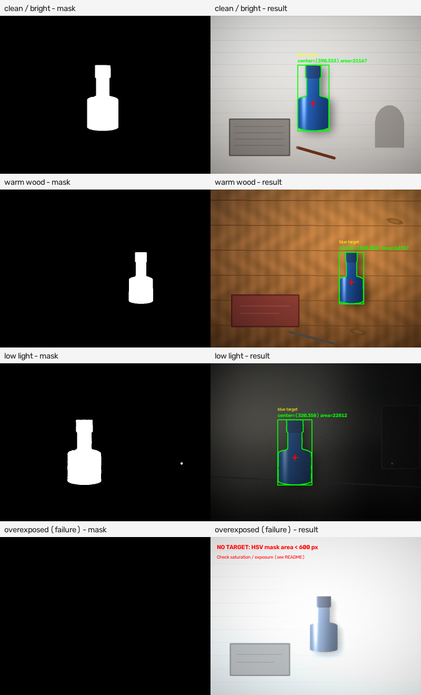
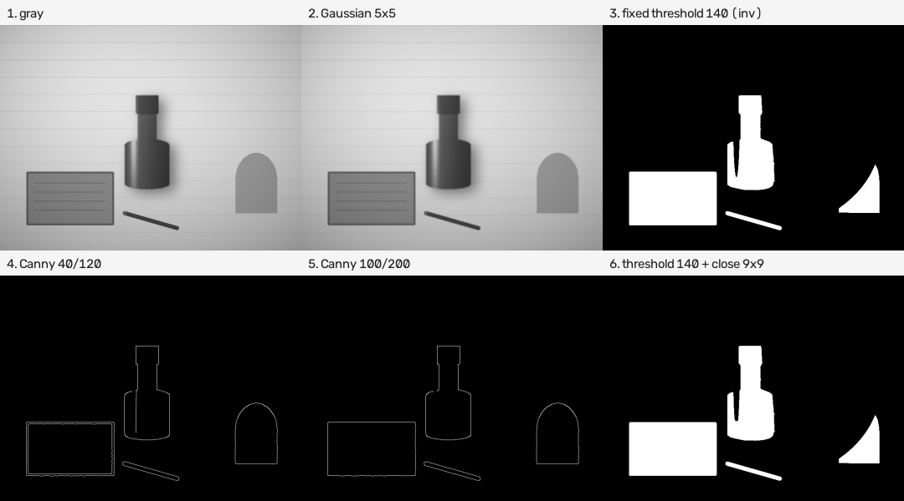
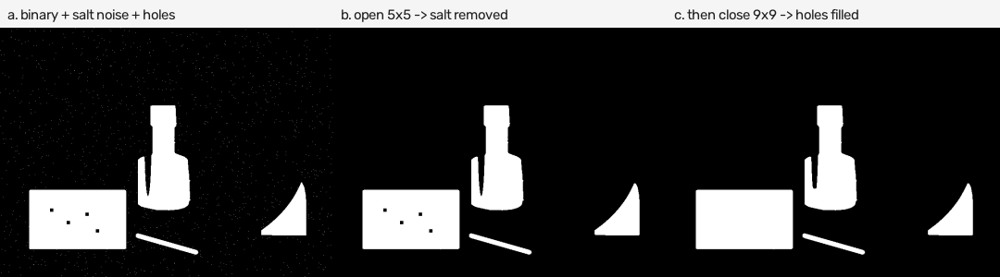

# 第一周：视觉算法环境搭建与基础图像处理

- 姓名：罗颢洋
- 提交目录：`W1_罗颢洋_视觉算法`
- 完成日期：2026-10-22
- 说明：本周只完成任务一、任务二、任务三；任务四（摄像头实时测试）为选做，未做。

---

## 1. 环境与依赖

| 项目 | 版本 / 说明 |
|---|---|
| 操作系统 | Windows 11（10.0.26200） |
| Python | 3.10.22（Conda 环境 `cv_practice`） |
| OpenCV | 5.0.0 |
| NumPy | 2.2.6 |
| Matplotlib | 3.10.9（按任务书安装，脚本本身不依赖它绘图） |

环境创建与安装命令（若已有环境可跳过）：

```bash
conda create -n cv_practice python=3.10 -y
conda activate cv_practice
pip install opencv-python numpy matplotlib
python -c "import cv2, numpy; print(cv2.__version__, numpy.__version__)"
```

实测导入结果：

```text
cv2 5.0.0
numpy 2.2.6
matplotlib 3.10.9
```

> 路径兼容性：本项目目录包含中文，Windows 下 `cv2.imread` / `cv2.imwrite`
> 可能因 ANSI 代码页而失败。因此 `src/image_io.py` 用
> `np.fromfile + cv2.imdecode` 读取、`cv2.imencode + tofile` 写入，
> 所有脚本都通过这两个函数访问图片。

---

## 2. 目录结构

```text
W1_罗颢洋_视觉算法/
├── README.md
├── requirements.txt
├── data/
│   ├── ground_truth.json          # 4 张测试图的蓝色目标外接框真值
│   └── images/
│       ├── scene_01_clean.png     # 明亮桌面，大目标
│       ├── scene_02_warm.png      # 暖色木桌，中等目标
│       ├── scene_03_lowlight.png  # 暗光环境，低照度
│       └── scene_04_overexposed.png # 过曝/低饱和，失败案例
├── src/
│   ├── image_io.py                # 支持中文路径的 OpenCV 读写封装
│   ├── make_test_images.py        # 生成可复现的测试图与真值
│   ├── learning_content_demo.py   # 学习内容配套代码（完整可运行版）
│   ├── task1_basics.py            # 任务一
│   ├── task2_processing.py        # 任务二
│   ├── task3_color_detect.py      # 任务三
│   └── run_all.py                 # 依次运行任务一至任务三
└── outputs/
    ├── learning/                  # 学习内容代码的中间结果与总览
    ├── task1/                     # 缩放、裁剪、灰度、对比图、回读报告
    ├── task2/                     # 灰度/滤波/阈值/Canny/形态学对比
    └── task3/                     # mask、result、overview、坐标 CSV
```

测试图说明：4 张图由 `src/make_test_images.py` 程序化生成，目的是固定背景、
光照、目标尺寸和真值，便于复现实验与计算 IoU；不是网上下载的素材。
如果换成真实照片，只需把 PNG 放进 `data/images/`，脚本会自动逐张处理；
`data/ground_truth.json` 中没有对应条目时，IoU 记为 0，不影响 mask 和
result 的生成。

---

## 3. 运行方式

所有命令都在**项目根目录** `W1_罗颢洋_视觉算法/` 下执行，代码内路径均以
项目根目录为基准，不依赖当前工作目录。

```bash
conda activate cv_practice

# 方式一：逐个运行
python src/learning_content_demo.py   # 学习内容配套代码
python src/task1_basics.py
python src/task2_processing.py
python src/task3_color_detect.py

# 方式二：一次运行三个任务（不会覆盖已有测试图）
python src/run_all.py

# 需要重新生成合成测试图和 ground_truth.json 时
python src/run_all.py --regenerate-data
```

单独运行某个脚本时也支持自定义输入输出目录，例如：

```bash
python src/task3_color_detect.py --input-dir data/images --output-dir outputs/task3
```

---

## 4. 学习内容：一段带注释的 OpenCV 代码

任务书第 2 节“学习内容”的表格，可以串成一条完整流水线：

```text
基础操作 -> 颜色空间 -> 图像预处理 -> 形态学 -> 轮廓与几何信息 -> 结果验证
```

下面这段代码按这 6 个板块逐段注释，覆盖了读图、BGR/RGB、缩放裁剪、
灰度/HSV、`inRange` 掩膜、三种滤波、固定/自适应阈值、Canny、
腐蚀/膨胀/开/闭运算、`findContours`、面积过滤、`boundingRect`、
`moments` 质心和结果回读。把代码保存为 `src/learning_core.py`
（与 `image_io.py` 同目录）即可运行；如果不想手动保存，直接运行完整版
`src/learning_content_demo.py`。

```python
"""学习内容核心代码：读图 -> HSV 掩膜 -> 形态学 -> 轮廓定位。"""

from pathlib import Path

import cv2
import numpy as np

from image_io import imread, imwrite

ROOT = Path(__file__).resolve().parents[1]
OUT = ROOT / "outputs" / "learning"
OUT.mkdir(parents=True, exist_ok=True)

# 1. 基础操作：读取图片，查看宽、高、通道数。
#    OpenCV 读进来就是 BGR 顺序，img.shape 是 (高, 宽, 通道数)。
bgr = imread(ROOT / "data/images/scene_01_clean.png")
if bgr is None:
    raise SystemExit("读图失败")
height, width, channels = bgr.shape
print(f"width={width}, height={height}, channels={channels}")

# 取一个像素，观察 B、G、R 三个分量；坐标顺序是 img[y, x]。
b, g, r = bgr[330, 390]
print(f"BGR=({b}, {g}, {r})")

# 2. BGR 与 RGB 的区别：cvtColor 改变通道顺序。
#    imwrite 默认按 BGR 解释数组，所以不能把 RGB 数组直接交给它。
rgb = cv2.cvtColor(bgr, cv2.COLOR_BGR2RGB)
print(f"RGB={tuple(int(value) for value in rgb[330, 390])}")

# 3. 缩放与裁剪：resize 的尺寸是 (宽, 高)，裁剪切片是 [y1:y2, x1:x2]。
resized = cv2.resize(bgr, (400, 300), interpolation=cv2.INTER_AREA)
cropped = bgr[150:450, 220:580].copy()
print(f"resized={resized.shape}, cropped={cropped.shape}")

# 4. 颜色空间：灰度只保留亮度；HSV 把颜色拆成色调/饱和度/明度。
gray = cv2.cvtColor(bgr, cv2.COLOR_BGR2GRAY)
hsv = cv2.cvtColor(bgr, cv2.COLOR_BGR2HSV)
hue, saturation, value = cv2.split(hsv)
print(f"H range=({hue.min()}, {hue.max()}), "
      f"S range=({saturation.min()}, {saturation.max()})")

# 5. 用 inRange 提取蓝色：三个通道都落在范围内才是白色目标。
#    H 在 OpenCV 中是 0~179，蓝色大约在 100~130。
lower = np.array([95, 90, 35], dtype=np.uint8)
upper = np.array([135, 255, 255], dtype=np.uint8)
mask = cv2.inRange(hsv, lower, upper)
masked = cv2.bitwise_and(bgr, bgr, mask=mask)  # 只保留目标区域

# 6. 三种滤波：均值、高斯、中值；核越大，平滑越强。
mean_blur = cv2.blur(bgr, (5, 5))
gaussian_blur = cv2.GaussianBlur(bgr, (5, 5), 0)
median_blur = cv2.medianBlur(bgr, 5)

# 7. 阈值与边缘：THRESH_BINARY_INV 让暗目标变白；Canny 找边缘。
_, fixed_threshold = cv2.threshold(gray, 140, 255, cv2.THRESH_BINARY_INV)
adaptive_threshold = cv2.adaptiveThreshold(
    gray, 255, cv2.ADAPTIVE_THRESH_GAUSSIAN_C, cv2.THRESH_BINARY_INV,
    blockSize=31, C=5,
)
edges = cv2.Canny(gray, 40, 120)

# 8. 形态学：开运算去小噪点，闭运算填小孔。
kernel5 = cv2.getStructuringElement(cv2.MORPH_ELLIPSE, (5, 5))
kernel7 = cv2.getStructuringElement(cv2.MORPH_ELLIPSE, (7, 7))
eroded = cv2.erode(mask, kernel5)
dilated = cv2.dilate(mask, kernel5)
opened = cv2.morphologyEx(mask, cv2.MORPH_OPEN, kernel5)
closed = cv2.morphologyEx(opened, cv2.MORPH_CLOSE, kernel7)

# 9. 轮廓与几何信息：面积过滤 -> 外接矩形 -> 矩求质心。
contours, _ = cv2.findContours(closed, cv2.RETR_EXTERNAL,
                               cv2.CHAIN_APPROX_SIMPLE)
contours = sorted(contours, key=cv2.contourArea, reverse=True)
valid = [c for c in contours if cv2.contourArea(c) >= 600]
if not valid:
    raise SystemExit("没有找到蓝色目标")
target = valid[0]
area = cv2.contourArea(target)
x, y, w, h = cv2.boundingRect(target)
moments = cv2.moments(target)
cx = int(round(moments["m10"] / moments["m00"]))
cy = int(round(moments["m01"] / moments["m00"]))
print(f"area={area:.0f}, bbox=({x},{y},{w},{h}), center=({cx},{cy})")

result = bgr.copy()
cv2.drawContours(result, [target], -1, (0, 255, 0), 2)
cv2.rectangle(result, (x, y), (x + w, y + h), (0, 255, 0), 2)
cv2.circle(result, (cx, cy), 5, (0, 0, 255), -1)

# 10. 结果验证：保存关键中间结果，并回读其中一张检查。
outputs = {
    "core_01_gray.png": gray,
    "core_02_mask.png": mask,
    "core_03_masked.png": masked,
    "core_04_mean.png": mean_blur,
    "core_05_gaussian.png": gaussian_blur,
    "core_06_median.png": median_blur,
    "core_07_threshold.png": fixed_threshold,
    "core_08_adaptive.png": adaptive_threshold,
    "core_09_canny.png": edges,
    "core_10_erode.png": eroded,
    "core_11_dilate.png": dilated,
    "core_12_open.png": opened,
    "core_13_close.png": closed,
    "core_14_result.png": result,
}
for name, image in outputs.items():
    imwrite(OUT / name, image)
reloaded = imread(OUT / "core_14_result.png")
print(f"readback shape_ok={reloaded.shape == result.shape}, "
      f"pixel_equal={np.array_equal(reloaded, result)}")
```

这段代码的 6 个观察点：

1. **`shape` 的顺序**是 `(高, 宽, 通道数)`，而 `resize` 的 `dsize` 是
   `(宽, 高)`；写反了图像会被拉伸。
2. **BGR 与 RGB**：同一个蓝色像素打印出来是 `BGR=(163,84,30)`、
   `RGB=(30,84,163)`；如果直接把 RGB 数组交给 `cv2.imwrite`，红色和蓝色
   会互换。
3. **HSV 的 H 是 0~179**，不是 0~360；蓝色大致在 H=100~130，`inRange`
   判断的是三个通道的“与”条件。
4. **掩膜是单通道 0/255 图**：白色是目标，黑色是背景；`bitwise_and`
   可以只保留目标区域的原始颜色。
5. **开运算和闭运算的顺序**：开运算先腐蚀后膨胀，去小噪点；闭运算先膨胀
   后腐蚀，填小孔。核越大效果越强，但也越容易改变目标形状。
6. **轮廓面积与质心**：`contourArea` 用来过滤噪声，`boundingRect` 给
   外接矩形，`moments` 给质心；质心不一定等于矩形中心，因为瓶身下宽上窄。

运行完整版（会额外保存 BGR/RGB 对比图、全部中间结果和参数记录）：

```bash
python src/learning_content_demo.py
```

完整版输出目录为 `outputs/learning/`，其中 `learning_overview.png` 是
6 格总览，`learning_notes.txt` 记录了本次运行的关键参数和测量值。


---

## 5. 任务一：图像基础操作

脚本：`src/task1_basics.py`

对 `data/images/` 下全部 4 张图执行：

1. 读取图片并检查是否成功，打印宽、高、通道数；
2. 缩放到宽 400 px（保持比例）；
3. 从缩放图中心裁剪 60% 区域；
4. 转灰度；
5. 保存缩放图、裁剪图、灰度图和三联对比图；
6. 重新读取保存文件，检查 shape 和逐像素是否一致；
7. 再次读取原图，确认原图内容未被修改。

4 张图原始尺寸均为 `800×600×3`，缩放后 `400×300×3`，中心裁剪
`240×180×3`，灰度图 `400×300`。`outputs/task1/readback_report.txt`
记录了每张图的回读结果，全部为：

```text
readback_shape_ok=True, pixel_equal=True
original unchanged: True
```

输出示例（`outputs/task1/comparison_scene_01_clean.png`）：

- 左：缩放后的彩色图
- 中：中心 60% 裁剪
- 右：灰度图

任务一关键点：OpenCV 默认按 BGR 通道读写，而 Matplotlib / Pillow 常用
RGB；若把 BGR 数组直接交给 `matplotlib.pyplot.imshow`，红、蓝通道会互换，
需要先 `cv2.cvtColor(img, cv2.COLOR_BGR2RGB)`。本项目只在 OpenCV 内部处理，
保存的也是 BGR 图片，因此不需要额外转换。为了无人值守运行，脚本不调用
`cv2.imshow`（会阻塞等待按键），而是把结果显示为保存的对比图。
`cv2.cvtColor(img, cv2.COLOR_BGR2GRAY)` 的灰度权重为
`0.114B + 0.587G + 0.299R`。

---

## 6. 任务二：基础图像处理对比

脚本：`src/task2_processing.py`，输入为 `scene_01_clean.png`。

### 6.1 输出文件

| 文件 | 内容 |
|---|---|
| `01_gray.png` | 灰度图 |
| `02_gaussian_5x5.png` | 5×5 高斯滤波 |
| `03_gaussian_15x15.png` | 15×15 高斯滤波 |
| `04_threshold_80.png` | 固定阈值 80（反向，白=暗目标） |
| `05_threshold_140.png` | 固定阈值 140 |
| `06_threshold_200.png` | 固定阈值 200 |
| `07_adaptive.png` | 自适应阈值，blockSize=31，C=5 |
| `08_canny_40_120.png` | Canny 低阈值 40 / 高阈值 120 |
| `09_canny_100_200.png` | Canny 低阈值 100 / 高阈值 200 |
| `10_morph_open_5x5.png` | 对阈值 140 做 5×5 开运算 |
| `11_morph_close_9x9.png` | 对阈值 140 做 9×9 闭运算 |
| `12_morph_noisy.png` | 人为加入椒盐噪声和小孔的阈值图 |
| `13_morph_open_demo.png` | 对 12 做开运算 |
| `14_morph_close_demo.png` | 再对 13 做闭运算 |
| `15_morphology_demo.png` | 12/13/14 三联对比 |
| `12_comparison.png` | 6 格总对比图 |
| `metrics.csv` | 各输出的均值、标准差、二值前景占比 |

共 16 张结果图，满足“不少于 5 张中间结果图”的要求。

### 6.2 参数对比与现象

`metrics.csv` 实测（800×600，前景占比 = 白色像素比例）：

| 输出 | 前景占比 | 现象 |
|---|---:|---|
| 阈值 80 | 3.04% | 只保留最暗的瓶身暗部和笔，蓝色瓶身大量丢失 |
| 阈值 140 | 13.20% | 瓶子基本完整，但深色笔记本、笔、灰色杯子边缘也被保留 |
| 阈值 200 | 53.86% | 大片浅灰桌面/阴影（亮度低于 200 的部分）也被判为目标，严重过分割 |
| 自适应 31/5 | 6.90% | 局部对比度分割，保留大量边缘/纹理，区域内部有空洞 |
| Canny 40/120 | 0.65% | 边缘多，桌面纹理和弱边缘也被检出 |
| Canny 100/200 | 0.48% | 边缘少，瓶子右侧弱边缘出现断裂 |
| 开运算 5×5 | 13.19% | 滤掉孤立白点，目标主体基本不变 |
| 闭运算 9×9 | 13.22% | 填补小孔，目标面积略增 |

具体结论：

- **滤波前后**：5×5 高斯使灰度标准差从 37.64 降到 37.20，15×15 降到
  36.60。数值变化不大，但视觉上 15×15 对桌面细纹和噪声更平滑，同时瓶口、
  瓶身边缘变软；后续做 Canny 时边缘定位会变粗。
- **阈值调低/调高**：阈值 80 时只有最暗区域变成白色，目标不完整；阈值 140
  时目标完整，但灰度阈值不区分颜色，深色笔记本和笔同样被保留；阈值 200
  时大面积浅色背景进入前景，说明固定灰度阈值对光照和背景非常敏感。
- **边缘是否完整**：Canny 40/120 能闭合瓶子外轮廓，但桌面纹理产生较多短
  边缘；Canny 100/200 噪声少，但瓶身右侧弱边缘会断开。高阈值减少误检、
  低阈值保留更多弱边缘，两者需要折中。
- **开运算/闭运算**：开运算是先腐蚀后膨胀，去掉孤立小点和细毛刺；闭运算是
  先膨胀后腐蚀，填补目标内部的小孔、连接近邻断裂。在干净的阈值 140 图上，
  开/闭运算只改变约 0.01/0.02 个百分点的前景像素，肉眼几乎看不出；为了展示作用，
  `12_morph_noisy.png` 人为加入了 1500 个椒盐白点和 4 个 8×8 小黑孔，
  开运算后前景占比从 13.41% 降到 13.14%（白点被清除），再闭运算回到
  13.22%（小黑孔被填补）。

> 任务二暴露的核心问题：**灰度阈值只能利用亮度，不能利用颜色**。因此任务三
> 改用 HSV 的 H/S/V 三通道范围来提取蓝色目标，而不是继续调灰度阈值。

---

## 7. 任务三：颜色目标提取与轮廓定位

脚本：`src/task3_color_detect.py`

### 7.1 处理流程

```text
BGR 读图
  -> GaussianBlur(3×3)                 抑制噪声
  -> cvtColor(BGR2HSV)                 分离色调/饱和度/明度
  -> inRange(lower, upper)             得到蓝色候选 mask
  -> morphologyEx(OPEN, 5×5)           去掉孤立噪点、细反光
  -> morphologyEx(CLOSE, 7×7)          填补目标内部小孔
  -> findContours(RETR_EXTERNAL)       只取外轮廓
  -> 按 contourArea >= 600 过滤         去掉显示器指示灯等小区域
  -> 取面积最大的轮廓
  -> boundingRect + moments            外接矩形、质心
  -> 在原图绘制轮廓、矩形、中心点、坐标和面积
  -> 保存 mask / result / CSV
```

### 7.2 参数及设置依据

| 参数 | 取值 | 依据 |
|---|---|---|
| H 下限/上限 | 95 / 135 | OpenCV 中蓝色约在 H≈100–130；向两侧留余量以容纳高光、阴影造成的色偏 |
| S 下限 | 90 | 蓝色瓶子饱和度约 180–210；暖色木桌 H≈16 已被 H 排除；S≥90 可去掉大部分灰白背景 |
| V 下限 | 35 | 暗光图中瓶子 V 约 50–80，仍高于 35；更低会把黑色背景纳入 |
| 最小面积 | 600 px² | 800×600 下目标面积约 1.2 万–2.3 万 px²；600 足以滤掉暗光图中 34 px² 的显示器指示灯 |
| 开运算核 | 5×5 椭圆 | 去掉 1–3 px 的孤立噪点/反光，不破坏瓶身主体 |
| 闭运算核 | 7×7 椭圆 | 填补瓶身高光造成的小孔；核再大会明显改变轮廓 |
| 高斯核 | 3×3 | 轻度平滑，避免把瓶口细结构模糊掉 |

### 7.3 检测结果

`outputs/task3/detections.csv` 实测（IoU 相对 `data/ground_truth.json`）：

| 图片 | 状态 | 中心坐标 (x,y) | 面积/px² | 外接矩形 (x,y,w,h) | 轮廓数（总/保留） | IoU |
|---|---|---|---:|---|---:|---:|
| scene_01_clean | OK | (390, 333) | 21,167 | (331, 187, 119, 250) | 1 / 1 | 1.0000 |
| scene_02_warm | OK | (535, 352) | 12,767 | (489, 238, 93, 196) | 1 / 1 | 0.9949 |
| scene_03_lowlight | OK | (320, 358) | 22,812 | (255, 214, 130, 248) | 2 / 1 | 0.9730 |
| scene_04_overexposed | MISS | — | — | — | 0 / 0 | 0.0000 |

> 中心点取的是二值 mask 的**质心**（`cv2.moments`）。瓶子下宽上窄，质心
> 天生比外接矩形几何中心略低；例如 clean 图外接矩形中心 y≈312，质心
> y=333。若需要“矩形中心”，可直接用 `(x+w/2, y+h/2)`，本脚本保留质心
> 是为了同时练习 `moments` 的用法。

输出文件：

- `mask_scene_01_clean.png` … `mask_scene_04_overexposed.png`
- `result_scene_01_clean.png` … `result_scene_04_overexposed.png`
- `mask.png` / `result.png`：clean 图的代表结果副本，便于按任务书文件名查找
- `overview.png`：4 组 mask/result 总览
- `detections.csv`：坐标、面积、轮廓数、IoU
- `params.json`：本次运行的全部参数

### 7.4 稳定性与误检/漏检分析

**稳定识别的情况：**

1. **clean（明亮桌面）**：蓝色与灰白背景差异大，mask 只有 1 个轮廓，
   外接矩形与真值完全一致，IoU=1.000。
2. **warm（暖色木桌）**：背景 H≈16、S 很高，但 H 不在 95–135 内，因此没有
   被误检；红色书本 H≈0 也被排除。说明 HSV 的 H 通道对“颜色种类”的区分
   比灰度阈值可靠。
3. **lowlight（暗光）**：瓶子 V 降到约 50–80，但 S 仍然很高；V 下限 35
   保证不漏检。图中显示器蓝色指示灯只有 34 px²，被最小面积 600 过滤掉，
   最终保留 1 个目标轮廓，IoU=0.973。

**失败/边界情况：**

- **过曝漏检（scene_04_overexposed）**：强光使瓶子整体向白色靠拢，
  S 最大只有 85，低于阈值 90，`inRange` 得到全黑 mask，最终 0 个轮廓，
  状态为 MISS。人眼仍能看出这是一只浅蓝色瓶子，但算法只依赖 S 就会漏检。
- **外接矩形与真值基本重合**：clean 完全一致，warm 底边多 1 px，lowlight
  左边界提前 2 px、宽多 3 px、底边多 1 px，IoU 0.973–1.000。阈值仍会把
  瓶身边缘的柔化过渡和少量阴影计入，mask 面积略大于真值可见面积；
  对“找到目标”影响很小，但高精度尺寸测量可先腐蚀 1–2 px 再取
  `boundingRect`。
- **质心偏移**：同上，底部阴影和“下宽上窄”形状使质心略低于几何中心；
  如果后续要控制机械臂抓取点，建议改用外接矩形中心，或先分割出瓶身
  主体再求质心。

### 7.5 失败案例与改进思路

本次最明确的失败案例是 **scene_04_overexposed**：

- **现象**：图片整体亮度高、瓶子颜色被冲淡；H 仍在蓝色范围，但 S 只有
  约 60–85；阈值 S≥90 把所有像素判为背景，mask 全黑，检测结果为 MISS。
- **原因**：HSV 的 S 表示颜色纯度。镜面高光/过曝会把 R、G、B 三个通道
  一起抬高，通道差值相对变小，S 随之下降；这不是“颜色变了”，而是
  “颜色被白光稀释了”。
- **直接调低 S 的后果**：把 S 降到 60 确实能让这张图的瓶子重新进入 mask
  （实测前景约 2.48%），但低照度图的前景会从 4.97% 升到 5.57%，带色反光和
  噪点也被一起放进来了；不同光照下最合适的 S 并不相同，盲目降低全局阈值
  只是把“漏检”换成“误检风险”，不能根本解决。
- **改进方向**：
  1. 拍摄端控制曝光，避免镜面高光；或对同一场景做多曝光/HDR 合成；
  2. 在 Lab 空间使用 a/b 通道，或使用归一化 RGB（r=R/(R+G+B) 等），
     降低亮度对颜色判别的影响；
  3. 用已知蓝色样本做直方图反投影或高斯颜色模型，而不是固定 H/S 范围；
  4. 增加形状先验：瓶子的长宽比、面积范围、轮廓实心度（solidity），
     把背景大块区域排除；
  5. 若目标可能过曝，可先检测高光区域，再在其邻域内用更低的 S 阈值
     做局部搜索；
  6. 视频场景可加时序滤波（多帧投票/卡尔曼跟踪），减少单帧漏检。

---

## 8. 复现与验收自查

| 任务 | 自查结果 |
|---|---|
| 任务一 | 4 张图均读取成功；缩放/裁剪/灰度共 12 张操作图 + 4 张对比图；回读 shape 和像素全部一致；原图未被覆盖 |
| 任务二 | 16 张结果图（含 6 格总对比、形态学三联图）；阈值 80/140/200、Canny 40/120 与 100/200、Gaussian 5×5/15×15 多组参数对比；`metrics.csv` 有量化记录 |
| 任务三 | 4 张测试图的 mask/result 全部输出；3 张稳定识别（IoU 0.973–1.000）；1 张过曝漏检并给出原因与改进；坐标、面积、bbox、轮廓数、参数均已落盘 |
| 学习内容 | `src/learning_content_demo.py` 已实测运行；`outputs/learning/` 含 20 个中间结果、BGR/RGB 对比图、6 格总览和 `learning_notes.txt`；README 第 4 节附完整带注释代码 |
| 代码 | 每个脚本可独立运行；路径基于项目根目录；中文注释；不覆盖原始图片 |
| 选做 | 任务四未做 |

复现时如果只想快速检查：

```bash
python src/learning_content_demo.py
python src/task1_basics.py
python src/task2_processing.py
python src/task3_color_detect.py
```

预期最后一行输出：

```text
3/4 scenes passed IoU >= 0.5; outputs: .../outputs/task3
```

---

## 9. 结果预览

任务三总览（左 mask，右 result；最后一行是过曝漏检案例）：



任务二总对比：



形态学作用演示（加噪 → 开运算去噪 → 闭运算填孔）：


